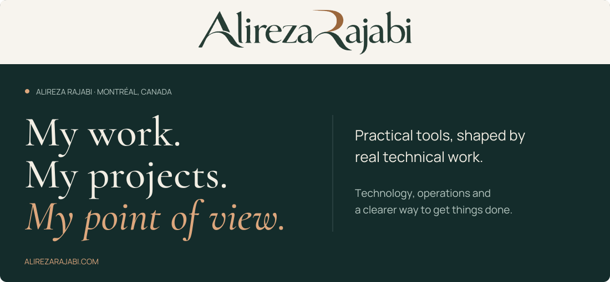

<a href="https://alirezarajabi.com/">
  <picture>
    <source media="(max-width: 600px)" srcset="assets/intro-mobile.svg">
    
  </picture>
</a>

I'm **Alireza Rajabi**, also known as **Alex**, based in Montréal, Canada.

My background is in technical service, business operations and supply chain management.
I design practical tools around the work people actually need to do: finding the
right reference, preparing the next step and keeping a clear record of the result.

### What I'm working on

1. **[Bizkonic](https://github.com/alirezarajabi-dev/bizkonic)** — Model-specific printer service references, organized for use in the field. [Website](https://bizkonic.com/)
2. **[Bizkonic Command-Desk](https://github.com/alirezarajabi-dev/command-desk)** — Command lookup, network references and SMTP guides. [Open app](https://alirezarajabi-dev.github.io/command-desk/)
3. **[Bizkonic Tools](https://github.com/alirezarajabi-dev/bk-tools)** — Six browser tools for everyday developer and freelance tasks. [Open app](https://alirezarajabi-dev.github.io/bk-tools/)
4. **[Bizkonic Forms](https://github.com/alirezarajabi-dev/field-report)** — A guided way to record a service visit and prepare a clear report. [Open app](https://alirezarajabi-dev.github.io/field-report/)

---

**[My website](https://alirezarajabi.com/)** · **[Connect on LinkedIn](https://www.linkedin.com/in/alireza-rajabi-04641040/)**
