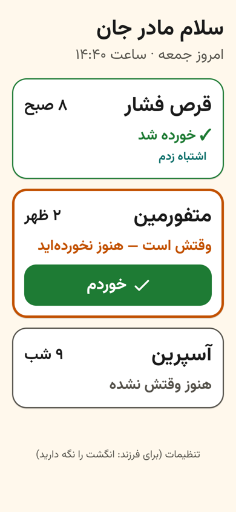
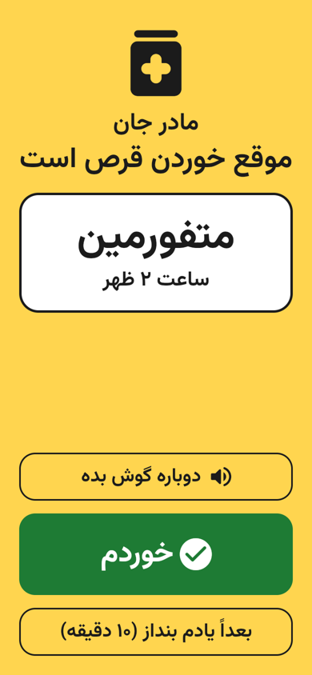
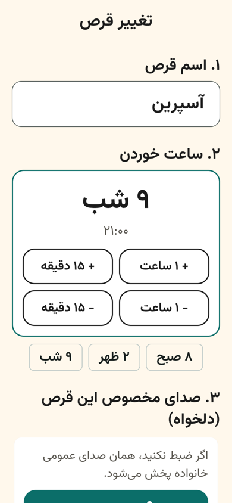
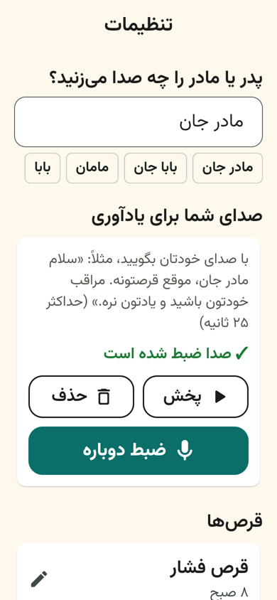

# یادآور قرص

اپی ساده برای پدر و مادرهای سالمند، با متن و دکمه‌های بزرگ و کاملاً فارسی.
سر ساعت هر قرص، **صدای خود فرزند** پخش می‌شود، مثلاً «سلام مادر جان، موقع
قرصتونه، مراقب خودتون باشید و یادتون نره» و اسم قرص با خط درشت روی صفحه می‌آید.
این اپ با Flutter نوشته شده و روی **آیفون و اندروید** کار می‌کند.

| صفحهٔ اصلی | موقع قرص | افزودن قرص | تنظیمات |
|---|---|---|---|
|  |  |  |  |

## امکانات

- فهرست قرص‌های امروز، با وضعیت هر قرص: «خورده شد»، «وقتش است» یا «هنوز وقتش نشده».
- یادآوری سر ساعت، حتی وقتی اپ بسته و گوشی قفل است. اینترنت لازم نیست.
- **صدای خودتان:** یک پیام کلی برای همهٔ قرص‌ها، و در صورت تمایل یک پیام جدا برای هر قرص.
  در آیفون همین صدا، صدای خود اعلان است.
- دکمهٔ سبز بزرگ «خوردم». اگر زده نشود، ۱۰ و ۲۰ دقیقه بعد دوباره یادآوری می‌کند.
- دکمهٔ «بعداً یادم بنداز» که ۱۰ دقیقهٔ دیگر دوباره یادآوری می‌کند.
- نام صدا زدن («مادر جان» یا «بابا جان») در متن یادآوری می‌آید.
- تنظیمات با **نگه داشتن انگشت** باز می‌شود تا پدر و مادر اشتباهی چیزی را تغییر ندهند یا پاک نکنند.
- اعداد فارسی، ساعت به شکل «۸ صبح» یا «۹ شب»، و فونت وزیرمتن.
- همهٔ اطلاعات فقط روی همان گوشی می‌ماند. حساب کاربری و سرور ندارد.

## نصب روی آیفون پدر و مادر

برای این کار یک **مک** با Xcode و Flutter لازم است.

1. روی مک: `cd pill-reminder && flutter pub get`
2. فایل `ios/Runner.xcworkspace` را در Xcode باز کنید. در بخش
   *Signing & Capabilities*، در قسمت Team، Apple ID خودتان را انتخاب کنید.
   اگر Xcode خطا داد، Bundle Identifier را به یک نام یکتا تغییر دهید.
3. آیفون را با کابل به مک وصل کنید و این دستور را بزنید: `flutter run --release`
4. روی آیفون، در Settings › General › VPN & Device Management، به برنامه‌نویس اعتماد کنید.
5. اپ را باز کنید و اجازهٔ **اعلان** و **میکروفون** را بدهید.
6. انگشت را روی «ثبت قرص‌ها» یا «تنظیمات» نگه دارید. نام صدا زدن را بنویسید،
   صدای خودتان را ضبط کنید و قرص‌ها را اضافه کنید.
7. دکمهٔ «یادآوری آزمایشی» را بزنید، گوشی را قفل کنید و ببینید صدا پخش می‌شود یا نه.

> **دربارهٔ حساب اپل:** با Apple ID رایگان، اپ نصب‌شده بعد از **۷ روز** از کار می‌افتد
> و باید دوباره از روی مک نصبش کنید. برای استفادهٔ همیشگی، یا برای نصب از راه دور با
> TestFlight، عضویت Apple Developer Program لازم است (سالی ۹۹ دلار).

### نکته‌های مهم آیفون

- اگر **کلید بی‌صدا** (کنار گوشی) روشن باشد، صدای اعلان پخش نمی‌شود و فقط لرزش دارد.
  آن را خاموش نگه دارید و صدای زنگ را زیاد کنید.
- اگر حالت **Focus** یا **خواب** روشن شود، اعلان‌ها ممکن است بی‌صدا شوند. در Xcode قابلیت
  *Time Sensitive Notifications* را به اپ اضافه کنید. کد از قبل یادآوری‌ها را «حساس به زمان»
  علامت می‌زند. سپس در تنظیمات Focus، یادآور قرص را مجاز کنید.
- آیفون در هر لحظه حداکثر ۶۴ یادآوری زمان‌بندی‌شده نگه می‌دارد. این برای حدود ده قرص کافی است.
- صدای ضبط‌شده حداکثر ۲۵ ثانیه است، چون آیفون صدای اعلانِ بلندتر از ۳۰ ثانیه را پخش نمی‌کند.

## نصب روی اندروید

`flutter run --release` یا `flutter build apk`. موقع باز کردن اپ، اجازهٔ اعلان،
«زنگ و یادآوری» و «نمایش تمام‌صفحه» را بدهید. در گوشی‌های شیائومی، سامسونگ و هواوی
اپ را از **بهینه‌سازی باتری** خارج کنید تا یادآوری دیر نرسد. در اندروید، اعلان صدای
زنگ ساعت را پخش می‌کند و با باز شدن صفحهٔ یادآوری، صدای شما پخش می‌شود.

## برای برنامه‌نویس

```
flutter pub get
flutter analyze
flutter test
```

| فایل | کار |
|---|---|
| `lib/reminders.dart` | زمان‌بندی یادآوری‌ها: روزانه، تکرار بعد از ۱۰ و ۲۰ دقیقه، و «بعداً» |
| `lib/voice.dart` | ضبط WAV در `Library/Sounds` (برای صدای اعلان آیفون) و پخش |
| `lib/store.dart` | ذخیرهٔ قرص‌ها و قرص‌های خورده‌شده روی گوشی |
| `lib/screens/` | صفحهٔ اصلی، صفحهٔ «موقع قرص»، افزودن قرص، تنظیمات |

فونت [وزیرمتن](https://github.com/rastikerdar/vazirmatn) با مجوز SIL OFL است (`assets/fonts/OFL.txt`).
