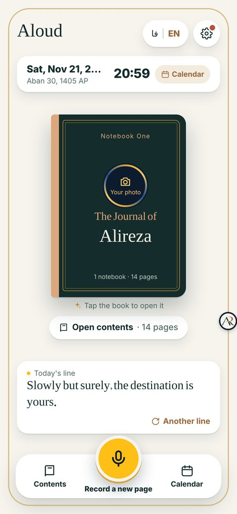
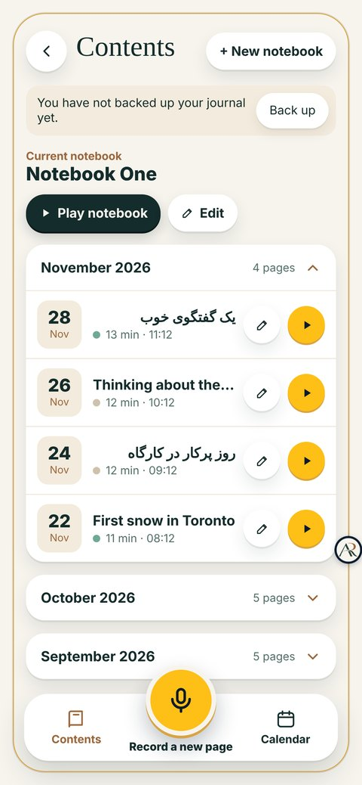
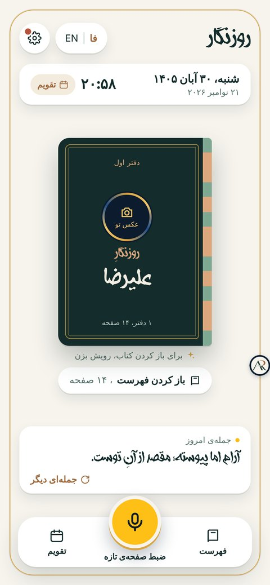

# Aloud · روزنگار

**A private voice journal that works like a real notebook.**
You speak your day, give it a title, and it becomes a page in your notebook.
The recordings stay on your phone; nothing is uploaded.

**[Open the app →](https://aloud.alirezarajabi.com/)** · Works in any phone browser · Add it to the Home Screen to use it like an app

<p>
  
  
  
</p>

## Why I built it

For years I recorded my days as long voice memos, sometimes an hour each, in a generic recorder app.
The files piled up with no order, no titles and no way to find a day again.
I wanted a journal made for speaking: press one big button, talk, and have the recording land in the right place,
with dates I understand, in both of my languages.

## What it does

- **One-tap recording** with a live waveform, pause, bookmarks and a screen that stays awake
- **Crash-safe**: audio is saved every few seconds, so a dropped call or a closed tab never loses a page
- **Notebooks and pages**: each recording becomes a page; pages fold by month so a long year stays short
- **Two calendars side by side**: Solar Hijri and Gregorian, with weekday and time
- **Fully bilingual**: Persian (right-to-left) and English, with names and notebook titles in both
- **A line for today**: the cover opens with an animated book and a hopeful daily line, read aloud
- **Imports an old archive**: brings in years of recordings from folders or zip files, dated automatically
- **Backup and restore** to a single file, so moving to a new phone is one step
- **Small files, clear voice**: mono speech encoding at about 14–21 MB per hour
- **Works offline** after the first visit

## How it is built

A static Progressive Web App in plain JavaScript, with no framework and no build step.

| Area | Approach |
|---|---|
| Storage | IndexedDB on the device; storage marked persistent |
| Recording | MediaRecorder with timed chunks, Wake Lock, Web Audio meter |
| Archives | A small zip writer and a streaming zip reader using `DecompressionStream` |
| Dates | `Intl.DateTimeFormat` with the Persian and Gregorian calendars |
| Navigation | History API so the phone's Back gesture closes sheets and steps back |
| Offline | Service worker, network first with a cached fallback |
| Security | Strict Content Security Policy; no third-party scripts, no tracking |
| Design | Cream, green and copper palette; Afsaneh and Vazirmatn for Persian, Kaushan Script and Manrope for English |

## Code samples

Short excerpts that show the approach. The full source is not published here.

**Recording that survives a crash.** Every five seconds the newest piece of audio is written to the device,
so if the browser closes mid-sentence the page can be rebuilt next time.

```js
this.mr.ondataavailable = (ev) => {
  if (!ev.data || !ev.data.size) return;
  const seq = this.seq++;
  DB.put('chunks', { session: this.sessionId, seq, blob: ev.data });
  DB.put('sessions', { id: this.sessionId, startedAt: this.startedAt,
                       elapsed: Math.round(this.elapsed() / 1000) });
};
this.mr.start(5000); // a chunk every 5 seconds
```

**Reading a large backup without loading it into memory.** Each file inside the zip is read
only when it is needed, and inflated as a stream.

```js
async blob(type) {
  const head = new DataView(await file.slice(localOff, localOff + 30).arrayBuffer());
  const start = localOff + 30 + head.getUint16(26, true) + head.getUint16(28, true);
  const raw = file.slice(start, start + csize);
  if (method === 0) return new Blob([raw], { type });
  const inflated = await new Response(
    raw.stream().pipeThrough(new DecompressionStream('deflate-raw'))
  ).blob();
  return new Blob([inflated], { type });
}
```

**Two calendars, both languages.** The Persian locale places the weekday last,
so the date is composed by hand to read naturally in each language.

```js
function fmtCal(date, cal, opts) {
  const loc = (lang() === 'fa' ? 'fa-IR' : 'en-US') + '-u-ca-' + cal;
  const out = new Intl.DateTimeFormat(loc, opts).format(date);
  return lang() === 'fa' ? out.replace(/,/g, '،') : out;
}
// "Saturday, 30 Aban 1405" above "21 November 2026"
const main = lang() === 'fa' ? 'persian' : 'gregory';
const line1 = fmtCal(now, main, { weekday: 'long' }) + '، ' +
              fmtCal(now, main, { day: 'numeric', month: 'long', year: 'numeric' });
```

**Keeping files small.** Speech does not need music-quality audio.

```js
const stream = await navigator.mediaDevices.getUserMedia({ audio: { channelCount: 1 } });
const bits = /opus|webm/.test(mime) ? 32000 : 48000; // ~14–21 MB per hour
this.mr = new MediaRecorder(stream, { mimeType: mime, audioBitsPerSecond: bits });
```

---

Designed and built by **[Alireza Rajabi](https://alirezarajabi.com/)**.
